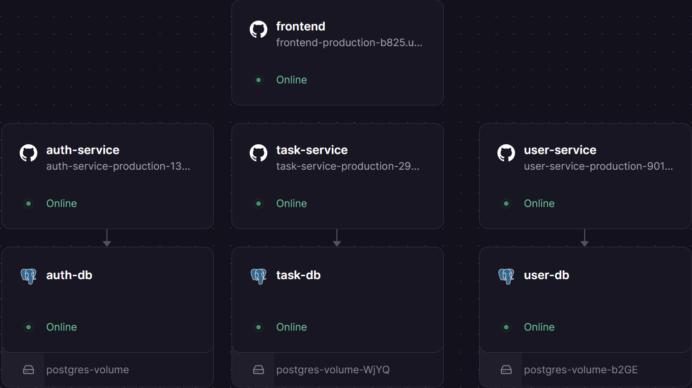
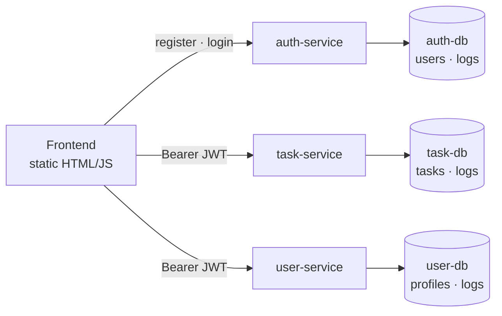

# Task Board — Microservices on Railway Cloud

**A team project that takes a shared-database task board and splits it into three independently deployed services, each owning its own PostgreSQL database (*database-per-service*), then ships everything to Railway cloud.**


> **ENGSE207 Software Architecture, Final Lab Set 2.** Team: Tawan Tiphkun (67543210033-6) and อติโรจน์ กุหลั่น (67543210049-2). It builds on [Final Lab Set 1](https://github.com/tawan230666/final-lab-set1).

## Deployed on Railway

All three services, their three databases and the frontend ran as separate Railway services:



> The cloud deployment was retired after grading. Run it locally with Docker in one command (below).

## Architecture



**Key decisions**

- **Database per service.** No service queries another service's tables. The old SQL `JOIN` between tasks and users was removed, and task-service now trusts the user ID inside the verified JWT.
- **Stateless auth.** auth-service issues the JWT; task-service and user-service verify it locally with the shared secret, so no extra network hop is needed per request.
- **Lazy profile creation.** The first `GET /api/users/me` creates the user's profile from token claims, so user-service never has to call auth-service.
- **Per-service logs.** The central log service from Set 1 was removed, and each service writes audit events into its own database.
- **Gateway option A.** The frontend calls each service URL directly (configured in `frontend/config.js`), which kept the Railway deployment simple.

## Run locally

```bash
git clone https://github.com/tawan230666/engse207-final-lab2-67543210033-6-67543210049-2.git
cd engse207-final-lab2-67543210033-6-67543210049-2
docker compose up --build
```

| URL | Service |
|---|---|
| http://localhost:8080 | Frontend |
| http://localhost:3001 | auth-service |
| http://localhost:3002 | task-service |
| http://localhost:3003 | user-service |

Seeded accounts: `alice@lab.local` / `alice123` (member), `admin@lab.local` / `adminpass` (admin).

## API walkthrough

```bash
AUTH=http://localhost:3001 TASK=http://localhost:3002 USER=http://localhost:3003

# Register a new user and log in
curl -X POST $AUTH/api/auth/register -H "Content-Type: application/json" \
  -d '{"username":"testuser","email":"test@example.com","password":"123456"}'
TOKEN=$(curl -s -X POST $AUTH/api/auth/login -H "Content-Type: application/json" \
  -d '{"email":"test@example.com","password":"123456"}' | jq -r .token)

# Profile is created automatically on first read, then updated
curl $USER/api/users/me -H "Authorization: Bearer $TOKEN"
curl -X PUT $USER/api/users/me -H "Authorization: Bearer $TOKEN" \
  -H "Content-Type: application/json" -d '{"display_name":"Test User"}'

# Tasks
curl -X POST $TASK/api/tasks -H "Authorization: Bearer $TOKEN" \
  -H "Content-Type: application/json" -d '{"title":"My Task","priority":"high"}'
curl $TASK/api/tasks -H "Authorization: Bearer $TOKEN"

# Admin-only: list every user
ADMIN=$(curl -s -X POST $AUTH/api/auth/login -H "Content-Type: application/json" \
  -d '{"email":"admin@lab.local","password":"adminpass"}' | jq -r .token)
curl $USER/api/users -H "Authorization: Bearer $ADMIN"
```

| Service | Endpoints |
|---|---|
| auth-service | `POST /api/auth/register`, `POST /api/auth/login`, `GET /api/auth/verify`, `GET /api/auth/me`, `GET /api/auth/logs` |
| task-service | `GET` / `POST /api/tasks`, `PUT` / `DELETE /api/tasks/:id` |
| user-service | `GET` / `PUT /api/users/me`, `GET /api/users` (admin) |

## Team split

| Member | Responsibilities |
|---|---|
| **Tawan Tiphkun** | Register API, per-service logging in auth-db, auth schema and seed data, deployed auth-service and auth-db |
| **อติโรจน์ กุหลั่น** | New user-service, removed cross-database JOINs from task-service, frontend profile page and gateway config, deployed task-service, user-service and the frontend |
| Both | Split docker-compose into three databases |

Full details: [TEAM_SPLIT.md](TEAM_SPLIT.md) and the individual reports. More evidence is in [`screenshots/`](screenshots).
